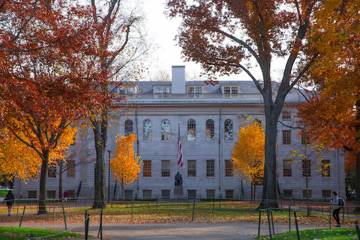
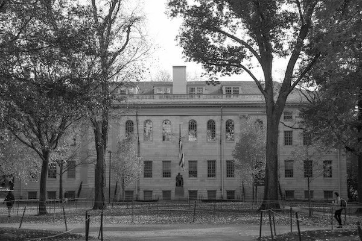
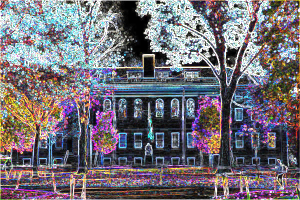
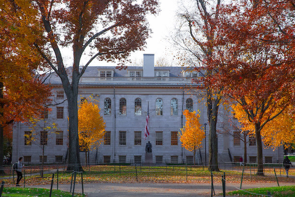

# Mini Tensor + BMP Image Library

A small C++17 project based on the supplied Tensor class and CS50 image filters.

## Files

- `Tensor.hpp`: header-only `Tensor<T>` template using `std::vector` for shape and contiguous row-major data.
- `Image.hpp` / `Image.cpp`: `Image : public Tensor<std::uint8_t>`, BMP loading/saving, and image filters.
- `main.cpp`: example that applies filters through `Image` member functions.

## Supported BMP format

Currently supports standard, uncompressed, 24-bit BMP files with a 40-byte `BITMAPINFOHEADER` and pixel data beginning at byte 54. Both bottom-up and top-down BMP row order are handled. BMP row padding is handled. Other BMP variants (8-bit, 32-bit, compressed, palettes, extended headers) are intentionally unsupported.

Pixels are stored in memory as RGB values in a tensor of shape `{height, width, 3}`. BMP files store channels in BGR order, so loading and saving convert between the two layouts.

## Build

```bash
g++ -std=c++17 -O2 -Wall -Wextra -pedantic main.cpp Image.cpp -o image_filters
```

Place `yard.bmp` in the program's working directory, then run:

```bash
./image_filters
```

The program writes:

- `yard_grayscale.bmp`
- `yard_reflected.bmp`
- `yard_blur.bmp`
- `yard_edges.bmp`
- `yard_sepia.bmp`

## Using the Image class

```cpp
#include "Image.hpp"

int main()
{
    Image image("yard.bmp");
    image.grayscale();
    image.save("yard_gray.bmp");
}
```

Filters modify the image in place. Load a fresh `Image` for each independent output, or copy an image before applying a filter.

## Tensor example

```cpp
Tensor<float> values({2, 2});
values.setElement(3.5f, {0, 1});
float value = values.getElement({0, 1});
```

The tensor supports element access, filling, reshape, addition, subtraction, and element-wise multiplication. It does not implement matrix multiplication.

## Image Filter Showcase

### Original Image


### Grayscale


### Blur


### Edge Detection


### Sepia


### Horizontal Reflection



## Performance Benchmarks

See [Benchmark Report](docs/BENCHMARK_REPORT.md) for detailed
performance comparisons with PyTorch and OpenCV.
