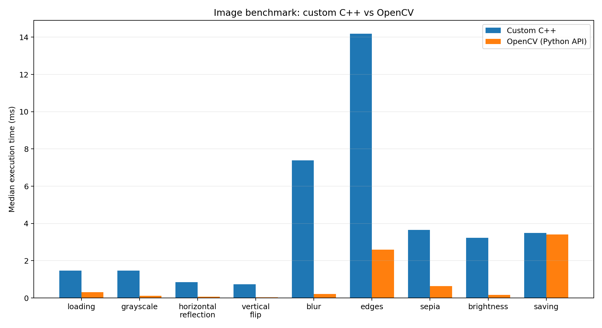
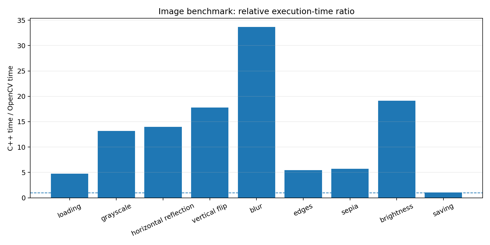
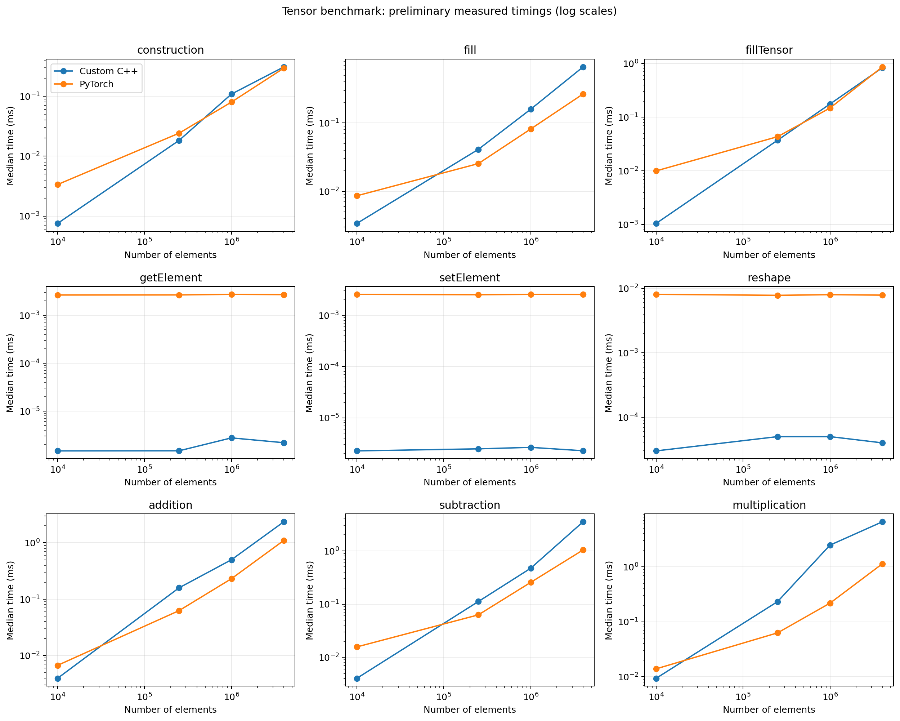

# Mini Tensor and BMP Image Library — Benchmark Report

## 1. Objective

This report compares the execution times of the custom C++ Mini Tensor and BMP Image Library with reference implementations using PyTorch and OpenCV. The measurements are intended to provide an initial performance profile and identify areas for optimization.

## 2. Test environment

- Operating system: Ubuntu 24.04 (GitHub Codespaces)
- Compiler: GCC 13.3.0
- C++ optimization: `-O2` (benchmark compile commands)
- CPU: AMD EPYC 7763; 2 available cores
- RAM: 7.8 GB
- C++ OpenCV package: 4.6.0
- Python OpenCV reported by benchmark: 5.0.0
- PyTorch reported by benchmark: 2.15.0+cu132
- Execution: CPU; Python benchmark scripts configured single-thread execution where applicable
- Repetitions: 15 per operation; median reported
- Image: `yard.bmp`, 600 × 400 pixels

## 3. Method

The C++ and Python reference benchmarks were run separately. The CSV files report median execution time in milliseconds. For image operations, the ratio is calculated as:

`C++ median time / OpenCV median time`

A ratio above 1 means the OpenCV measurement was faster; below 1 means the custom C++ measurement was faster.

The image benchmark measures loading, grayscale, horizontal reflection, vertical flip, blur, edges, sepia, brightness, and saving.

The Tensor benchmark measures construction, fill, fillTensor, getElement, setElement, reshape, addition, subtraction, and element-wise multiplication for 10,000, 250,000, 1,000,000, and 4,000,000 elements.

## 4. Image benchmark results

| Operation | Custom C++ (ms) | OpenCV Python API (ms) | C++ / OpenCV | Lower measured time |
|---|---:|---:|---:|---|
| loading | 1.473880 | 0.311531 | 4.73× | OpenCV |
| grayscale | 1.475100 | 0.112060 | 13.16× | OpenCV |
| horizontal reflection | 0.847852 | 0.060603 | 13.99× | OpenCV |
| vertical flip | 0.732867 | 0.041177 | 17.80× | OpenCV |
| blur | 7.389460 | 0.219369 | 33.69× | OpenCV |
| edges | 14.190300 | 2.595852 | 5.47× | OpenCV |
| sepia | 3.648590 | 0.641126 | 5.69× | OpenCV |
| brightness | 3.234300 | 0.169075 | 19.13× | OpenCV |
| saving | 3.483740 | 3.403937 | 1.02× | OpenCV |

### Image result interpretation

In these measurements, OpenCV's reported median was lower for all nine operations. The largest measured ratio was for blur; saving was the closest comparison.

These results are not a perfectly controlled comparison of identical implementations:

- Grayscale: the custom implementation averages RGB channels and retains three channels, while OpenCV's BGR-to-gray conversion uses weighted channels and returns one channel.
- Blur: the custom implementation averages valid in-bounds neighbors; OpenCV uses its own default border handling.
- Edges: the custom implementation uses Sobel gradient magnitude, while the OpenCV reference uses Canny edge detection. These are different algorithms.
- Brightness: the implementations have similar positive scaling intent, but conversion and saturation details may differ.
- Loading and saving include each library's own decoding, encoding, and pixel/channel handling.

Therefore, interpret this as a practical library-level comparison, not proof that equivalent algorithms differ by exactly the displayed factor.

## 5. Tensor benchmark results

**Important: preliminary results only.** The C++ arithmetic benchmark may allow the optimizing compiler to eliminate work if calculated output elements are not sufficiently consumed. The C++ and PyTorch scalar-access timings also include different API and language overheads. Do not treat these ratios as definitive until the benchmark is revised to prevent dead-code elimination and to make the compared work equivalent.

| Operation | Elements | Custom C++ (ms) | PyTorch (ms) | C++ / PyTorch |
|---|---:|---:|---:|---:|
| addition | 10,000 | 0.003937 | 0.006682 | 0.59× |
| construction | 10,000 | 0.000752 | 0.003356 | 0.22× |
| fill | 10,000 | 0.003376 | 0.008576 | 0.39× |
| fillTensor | 10,000 | 0.001052 | 0.010018 | 0.11× |
| getElement | 10,000 | 0.000001 | 0.002658 | 0.00× |
| multiplication | 10,000 | 0.009337 | 0.013886 | 0.67× |
| reshape | 10,000 | 0.000030 | 0.008096 | 0.00× |
| setElement | 10,000 | 0.000002 | 0.002553 | 0.00× |
| subtraction | 10,000 | 0.004017 | 0.015649 | 0.26× |
| addition | 250,000 | 0.158877 | 0.062606 | 2.54× |
| construction | 250,000 | 0.018334 | 0.024205 | 0.76× |
| fill | 250,000 | 0.041006 | 0.025377 | 1.62× |
| fillTensor | 250,000 | 0.037419 | 0.043532 | 0.86× |
| getElement | 250,000 | 0.000001 | 0.002666 | 0.00× |
| multiplication | 250,000 | 0.232725 | 0.062817 | 3.70× |
| reshape | 250,000 | 0.000050 | 0.007835 | 0.01× |
| setElement | 250,000 | 0.000002 | 0.002512 | 0.00× |
| subtraction | 250,000 | 0.111639 | 0.062706 | 1.78× |
| addition | 1,000,000 | 0.499722 | 0.230470 | 2.17× |
| construction | 1,000,000 | 0.108823 | 0.079940 | 1.36× |
| fill | 1,000,000 | 0.158606 | 0.081442 | 1.95× |
| fillTensor | 1,000,000 | 0.176398 | 0.148396 | 1.19× |
| getElement | 1,000,000 | 0.000003 | 0.002738 | 0.00× |
| multiplication | 1,000,000 | 2.474660 | 0.217676 | 11.37× |
| reshape | 1,000,000 | 0.000050 | 0.008005 | 0.01× |
| setElement | 1,000,000 | 0.000003 | 0.002550 | 0.00× |
| subtraction | 1,000,000 | 0.471829 | 0.255787 | 1.84× |
| addition | 4,000,000 | 2.355950 | 1.099832 | 2.14× |
| construction | 4,000,000 | 0.308996 | 0.294569 | 1.05× |
| fill | 4,000,000 | 0.659179 | 0.264944 | 2.49× |
| fillTensor | 4,000,000 | 0.835138 | 0.864864 | 0.97× |
| getElement | 4,000,000 | 0.000002 | 0.002702 | 0.00× |
| multiplication | 4,000,000 | 6.576220 | 1.132963 | 5.80× |
| reshape | 4,000,000 | 0.000040 | 0.007885 | 0.01× |
| setElement | 4,000,000 | 0.000002 | 0.002542 | 0.00× |
| subtraction | 4,000,000 | 3.521780 | 1.041162 | 3.38× |

### Tensor result interpretation

The recorded timings generally increase with the number of elements for operations that process the full tensor. The measured reshape and scalar-access timings are comparatively insensitive to tensor size, which is consistent with the implementations' API-level operations, but these measurements are affected by different implementation details and overheads.

The C++ reshape changes shape metadata after validating the element count. PyTorch reshape may return a view or a copy depending on layout. Likewise, C++ getElement/setElement calls and Python tensor indexing plus scalar extraction are not equivalent low-level memory-access measurements.

Before drawing performance conclusions, revise the C++ arithmetic benchmark so every output contributes to an observable checksum or equivalent validation outside the timed region, while ensuring the compiler cannot remove the computation. Then rerun both implementations using equivalent input data, output consumption, and timing boundaries.

## 6. Limitations

1. C++ and Python reference measurements compare complete library/API usage, not programming languages in isolation.
2. The Tensor arithmetic results are preliminary because of possible compiler dead-code elimination.
3. Tensor scalar access includes different API and language overhead.
4. Some image operations use different algorithms or output formats, as described above.
5. Results are from one Codespaces environment and one 600 × 400 BMP image; different hardware, image sizes, compiler versions, and library builds may produce different timings.
6. Median timings are reported; the source CSVs also include average timings where available.

## 7. Conclusion

The image measurements show lower execution times for the OpenCV reference implementation across all tested operations, with the largest difference in blur and the smallest in saving. However, the algorithms and API behavior are not identical in every case, so the ratios should be interpreted as practical reference comparisons.

The Tensor measurements provide an initial baseline across four tensor sizes. They require a corrected arithmetic benchmark before a reliable performance conclusion can be made.

The project demonstrates the implementation and measurement of contiguous tensor storage, element-wise arithmetic, BMP loading and saving, and common image filters. Future work should focus on equivalent benchmark workloads, preventing compiler optimization from removing measured work, and improving the image algorithms' performance.

## 8. Reproducibility

The original benchmark CSV files are retained separately. The comparison CSV files and generated charts in this report package are derived from those uploaded CSVs.

The benchmark scripts require their corresponding Python dependencies to be installed in the environment before rerunning.
